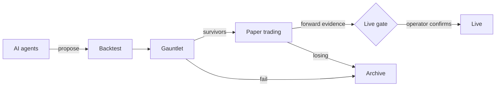

<p align="center">
  
</p>

<p align="center">
  <strong>A self-hosted workspace where AI agents research crypto trading strategies, and a strict evidence pipeline decides which ones deserve your attention.</strong>
</p>

<p align="center">
  <a href="LICENSE"></a>
  <a href="https://github.com/judder659/Forven/actions/workflows/ci.yml"></a>
  
  
  <a href="https://forven.app"></a>
  <a href="https://discord.gg/vzSQTneq6a"></a>
</p>

---

> [!WARNING]
> **Research software. Not financial advice.** Forven runs in **paper mode** by default: strategies trade with simulated fills against live market data, and no real money is at risk. Real-money trading exists in the code but is unsupported, off by default, and needs several deliberate opt-ins. Backtest and paper results do not predict live results, and Forven's own metrics can be wrong. See [`DISCLAIMER.md`](DISCLAIMER.md).

## Why Forven

Most trading ideas look good in a backtest and fail with real data. Forven is built around that fact. It generates many candidate strategies, tries hard to break each one, and only lets the survivors collect forward evidence in paper trading. Everything runs on your own machine, with your own model and exchange credentials, and there is no Forven account or server.

## Features

| | |
|---|---|
| **AI research team** | Strategy, quant-research, risk and execution agents propose hypotheses, write strategy code and run it through validation. Works with OpenAI, Anthropic, MiniMax, OpenRouter, DeepSeek, Gemini, Mistral, xAI and Groq, by API key or (for supported providers) OAuth sign-in. |
| **Backtester** | Bar-by-bar execution with vectorised signal generation, cost and slippage modelling, and a research holdout period that strategies never see during development. |
| **The Gauntlet** | A robustness battery (walk-forward, Monte Carlo, parameter jitter, cost stress, regime split) plus an optional Deflated Sharpe check. It decides which strategies advance. |
| **Paper trading** | Survivors paper-trade automatically with stop-losses, a drawdown kill switch and fill reconciliation. A breadth test across about 15 coins can let a strategy paper-trade several coins at once. |
| **Live gate** | Moving from paper to live needs a forward track record (20+ trades over 30+ days), a statistical test on that evidence, and the operator's explicit confirmation. Nothing goes live on its own. |
| **Bot Factory** | Build AI-driven or rule-based bots (grid, DCA, signal follower), replay them on history and compare them side by side. Bots never hold exchange keys, and on Windows they run in a sandbox. |
| **Dashboard** | A SvelteKit operator console for the pipeline, strategies, agents, risk, data, approvals and diagnostics. |
| **MCP server** | Drive Forven from Claude, Codex or any other MCP client. See [`docs/mcp-server.md`](docs/mcp-server.md). |

## Project status

Forven is under active development and changes quickly. It is a research tool: **no strategy produced by Forven has yet been proven profitable in live trading**, and you should treat every reported number with skepticism until it holds up on forward data.

## Quick start

**Requirements:** Python 3.11+, Node.js 18+ and git.

```bash
git clone https://github.com/judder659/Forven.git
cd Forven
```

### Windows

The PowerShell launcher creates `.venv`, installs backend and frontend dependencies, initialises the database and starts everything:

```powershell
$env:START_BOT = '0'
$env:START_DAEMON = '0'
powershell -ExecutionPolicy Bypass -File .\start_all.ps1
```

For a desktop window with Start, Stop and Restart buttons, see [`docs/desktop-launcher.md`](docs/desktop-launcher.md).

### macOS / Linux

```bash
python3 -m venv .venv
source .venv/bin/activate
python -m pip install --upgrade pip
python -m pip install -e .
(cd frontend && npm install)
cp .env.example .env
START_BOT=0 START_DAEMON=0 bash start_all.sh
```

Then open **http://127.0.0.1:5173**. The API listens on `http://127.0.0.1:8003` (health check: `/api/health`). [`docs/FIRST_RUN_CHECKLIST.md`](docs/FIRST_RUN_CHECKLIST.md) walks through the first session.

### Connect a model provider

Your keys stay on your machine and are never sent to any Forven server.

- **API key:** add it in the dashboard under **Settings → Agents**, or set the provider's environment variable before starting (for example `OPENAI_API_KEY` or `ANTHROPIC_API_KEY`).
- **OAuth sign-in:** `python -m forven auth login openai` (or `minimax`). Check with `python -m forven auth status`.

Exchange credentials (Hyperliquid testnet by default) are added under **Settings**. Paper trading needs no exchange keys.

## How it works



1. **Propose.** Agents write strategies from hypotheses, research sources and past results.
2. **Test.** Each strategy is backtested, then put through the Gauntlet.
3. **Paper.** Strategies that aren't broken or clearly losing enter a capped paper pool and trade forward. Losers are retired automatically.
4. **Decide.** Only a strategy with enough forward evidence is offered for live trading, and only the operator can approve it.

More detail: [`docs/ARCHITECTURE.md`](docs/ARCHITECTURE.md) and [`docs/USER_MANUAL.md`](docs/USER_MANUAL.md).

## Tech stack

| Layer | Technology |
|---|---|
| Backend | Python 3.11+, FastAPI, uvicorn |
| Frontend | SvelteKit 2, Svelte 5, Tailwind CSS, Vite |
| Storage | SQLite and workspace files under `FORVEN_HOME` (default `~/.forven`); ChromaDB for agent memory; DuckDB/Parquet market data |
| Exchanges | Hyperliquid (testnet by default), via CCXT and the Hyperliquid SDK |

## Configuration and safety

Start from [`.env.example`](.env.example) and set only what you need. The settings that matter most:

| Setting | Default | What it does |
|---|---|---|
| `FORVEN_EXECUTION_MODE` | `paper` | `paper` is the only supported mode. `live` is unsupported; a real-money order also needs `FORVEN_ALLOW_MAINNET=1` and mainnet credentials. |
| `FORVEN_BIND_HOST` | `127.0.0.1` | Localhost only, for both the API and the dashboard on :5173. Binding to `0.0.0.0` or a LAN address requires `FORVEN_API_KEY` and `FORVEN_OPERATOR_KEY`, or the app refuses to start; it also lets other devices open the dashboard. |
| `FORVEN_API_KEY`, `FORVEN_OPERATOR_KEY` | unset | Protect the API and its dangerous endpoints. Set both if anything beyond your own machine can reach it. |
| `START_BOT`, `START_DAEMON` | varies | Start the Discord bot and the separate trading daemon. |
| `FORVEN_HOME` | `~/.forven` | Where the database, logs and workspace live. |

Never commit `.env`, `*.db`, auth tokens or API keys (they are gitignored). Security reports go through [`SECURITY.md`](SECURITY.md).

## Development

```bash
# Backend only
python -m uvicorn --app-dir . forven.api:app --host 127.0.0.1 --port 8003 --reload

# Frontend only
cd frontend && npm run dev

# CLI
python -m forven --help

# Tests and checks
python -m pytest tests -q
python -m ruff check forven tests
cd frontend && npm test && npm run check
```

## Documentation and community

- **Docs:** [forven.app](https://forven.app), plus the [`docs/`](docs/) folder
- **Discord:** [discord.gg/vzSQTneq6a](https://discord.gg/vzSQTneq6a)
- **Reddit:** [r/Forven](https://www.reddit.com/r/Forven/)
- **X:** [@forvenapp](https://x.com/forvenapp)

## Contributing

Issues, ideas and discussion are very welcome. Forven is **not yet accepting outside code contributions** because a contributor agreement isn't in place. See [`CONTRIBUTING.md`](CONTRIBUTING.md) and the [`CODE_OF_CONDUCT.md`](CODE_OF_CONDUCT.md). Please report security issues privately as described in [`SECURITY.md`](SECURITY.md).

## License

Copyright (C) 2026 Judder &lt;judder@forven.app&gt;

Forven is free software under the [GNU Affero General Public License v3.0 or later](LICENSE), distributed without any warranty. If you run a modified version as a network service, you must offer its source to the people using it (AGPL §13). The "Forven" name and logo are not covered by the license: see [`TRADEMARK.md`](TRADEMARK.md) and [`NOTICE`](NOTICE).
